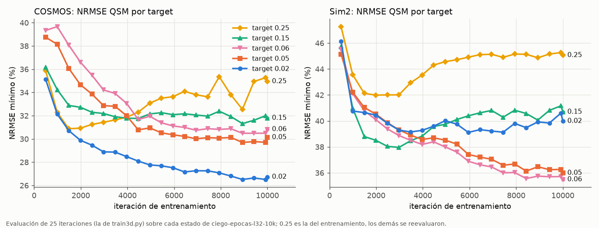
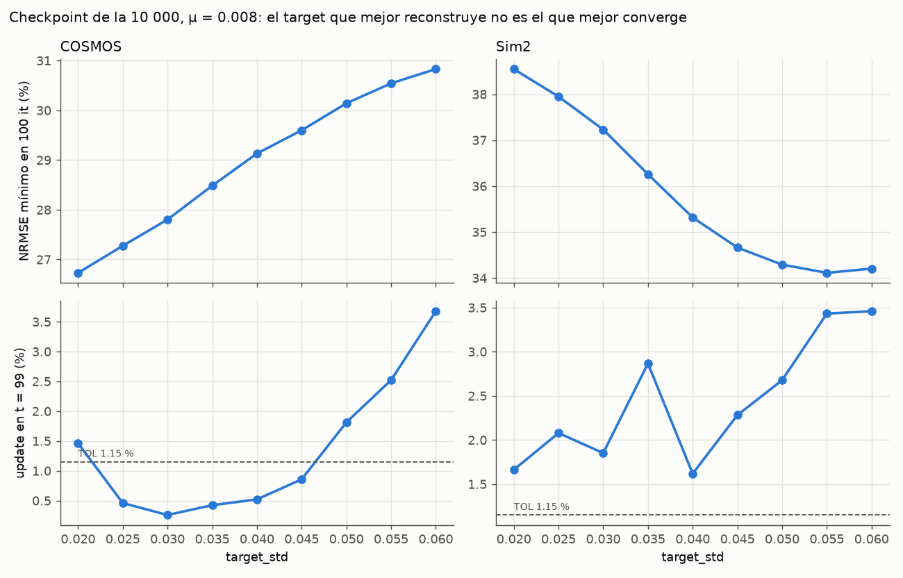
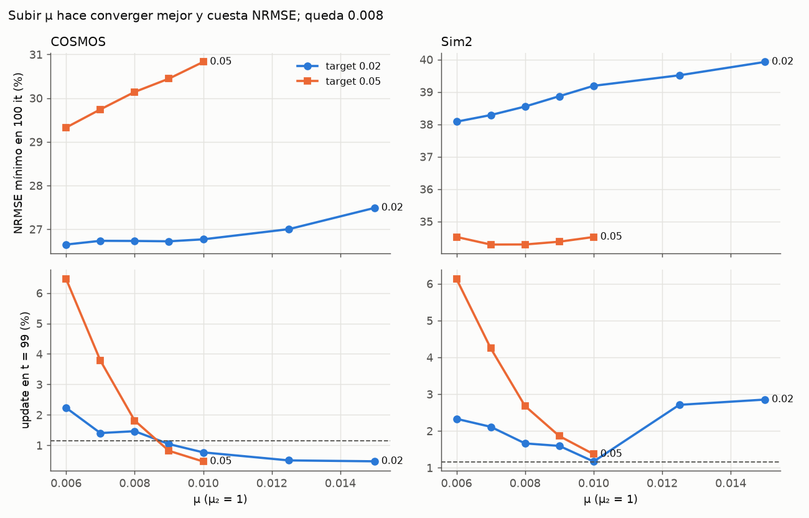

# Sanity Check: resumen al 25-10

`docs/Sanity Check/` guarda las figuras de las mediciones del 21 y 22-10 (~14 MB, fuera de git).
Esta carpeta, `resumen/`, sí va en git: resume lo vigente con tres figuras nuevas e inventaría las
viejas. Los detalles y los números de cada medición están en `docs/bitacora.md`.

## La auditoría del 26-10 (`../26-10-auditoria-ruido/`)

Pedida por el supervisor: si el ruido inyectado tiene el SNR que dice y si COSMOS y Sim2 son
simulados. Los números, en `docs/bitacora.md` («Auditoría del ruido y de los datos QSM», 26-10).

- `26-10-1-ruido_inyectado_t1.png`: el ruido de la validación a SNR 10.2, 25, 50 y 100 por el
  máximo absoluto (que vale 1 en los 12 volúmenes), con zoom de un píxel por vóxel, el histograma
  de ruidosa − limpia y, al lado, el «SNR 25» de las figuras viejas (SNR 79 por el máximo).
- `26-10-2-denoising_red_vigente.png`: la red de la 14 880 a esos SNR, con las métricas en el
  cerebro.
- `26-10-3-campos_cosmos_sim2.png`: la fase de COSMOS es D∗χ_COSMOS más ruido blanco complejo de
  SNR 100 por el máximo (un crimen inverso); la de Sim2 trae un desajuste con estructura.

## Antes de mirar las figuras viejas

- **Todas usan la convención de SNR vieja:** la media del cerebro sobre σ (0.316/σ). La vigente,
  desde el 23-10, es pico/σ con pico 1: SNR_pico = SNR_media / 0.316 (3.2 → 10.2, 25 → 79,
  50 → 158, 100 → 316). Por eso su «SNR 25» muestra 3.16 veces menos ruido que un SNR 25 por
  el máximo, la explicación más probable de que el supervisor viera menos ruido que el rotulado.
  Sólo `por-que-no-reescalar/22-10-por-que-no-reescalar.txt` lo aclara.
- **Ninguna muestra la red vigente:** son redes cortas ya superadas (la control de σ fijo, 1 500
  iteraciones; la de sobreajuste; `etapa2-ciega`; `ciego-log-l32` y `prep3d-g10-s2-2500`, 2 250).
- **De las tres semillas de ruido queda `seed1/`:** la semilla mueve el NRMSE ≤ 0.01 pp.
- `21-10-perillas_admm.png` y `21-10-pnp_por_iteracion_alfa.png` sostuvieron la propuesta de un
  α fijo 0.25. Con la red ciega entrenada esa propuesta se reemplazó por varios targets (abajo).

## Lo vigente (red `ciego-epocas-l32-10k`, 10 000 iteraciones)

**Red y ADMM.** TDV 3D real (`VNet3D`, convoluciones 3D), entrenada con ruido ciego log-uniforme
σ ∈ [0.81, 55]/255, épocas y lote 32. La evaluación QSM es el ADMM de `../tdv`
(`wTDV_QSM_torch_3d.py`) con k = 1: la red 3D sobre el volumen entero, μ = 0.008, μ₂ = 1 y
α = target_std / std(χ₀).

**Denoising en el cerebro, en la 10 000.** PSNR 33.79 dB, el mejor de la corrida. NRMSE de
entrada → salida: SNR 25: 12.19 → 4.18 %; SNR 50: 6.10 → 3.27 %; SNR 100: 3.05 → 2.17 %.

**QSM por target** (`25-10-qsm-por-target.png`). Con el target fijo en 0.25, la evaluación del
entrenamiento decía que el QSM empeoraba desde la 1 488. Reevaluando cada estado, a 0.02 y 0.05–0.06
mejora durante todo el entrenamiento:
- COSMOS a 0.02: de 35.1 % (496) a 26.7 % (10 000);
- Sim2 a 0.06: de 45.5 % a 35.5 %.

El mejor target depende del sujeto, y desde la 8 432 las curvas están casi planas.

**Grid de target, checkpoint de la 10 000** (`25-10-grid-target.png`). En COSMOS el NRMSE sube con
el target (0.02 es el mejor, 26.73 %, pero no baja del TOL). En Sim2 baja hasta 0.055 (34.11 %), y
ningún target converge. La evaluación de las corridas vigentes usa 0.15, 0.02 y 0.05, y cuenta el
de menor NRMSE.

**μ** (`25-10-mu.png`). Subirlo siempre mejora la convergencia y cuesta hasta 1.5 pp de NRMSE,
según el sujeto y el target. Pasado 0.01, Sim2 empeora en las dos cosas. Queda μ = 0.008.

**Lo que no sirvió:**
- **El ADMM en dos rondas** (target fuerte y después suave): el ADMM se va a la solución del suave
  y el update sube a 6–8 %.
- **Un α sin GT por el ruido estimado de χ₀:** la escala fina ve el 20–30 % del error, que es
  sobre todo suave.
- **El principio de discrepancia:** toda reconstrucción deja menos residuo de dato que el χ
  verdadero.

## Inventario de las figuras viejas

Estados: «vigente» es una medición válida de su red; «snr vieja» es correcta pero rotulada con la
convención vieja.

| archivo | qué muestra | estado |
|---|---|---|
| `21-10-ganancia_vs_contraste.png` | Barrido de s (reescalado del paper), red control 1 500 it: ganancia en dB contra s, con el rango del paper y el s que corresponde a cada target_std | snr vieja |
| `21-10-perillas_admm.png` | NRMSE mínimo del ADMM (red control, COSMOS, 25 it) contra target_std, T de inferencia y μ, una perilla por vez; target y μ, rehechos con la red vigente en `25-10-grid-target.png` y `25-10-mu.png` | vigente |
| `21-10-pnp_ciega_vs_control.png` | Dentro del ADMM, a target 0.06: NRMSE por iteración y energía del error en el cono y fuera, sale/entra; etapa2-ciega σ~U(0,55) contra la control | vigente |
| `21-10-pnp_entrada_salida.png` | Corte sagital de COSMOS: referencia, lo que entra y sale de la red y sus diferencias, a t = 1, 5, 10 y 25 (crecen las rayas del cono) | snr vieja |
| `21-10-pnp_por_iteracion.png` | Cinco paneles por iteración del ADMM (control, target 0.06): NRMSE, SNR de entrada, ganancia de la red, fracción del error en el cono y razón de energía | snr vieja |
| `21-10-pnp_por_iteracion_alfa.png` | ADMM con la control a target 0.06, 0.25 y 0.35, 100 it: NRMSE, error de entrada en unidades de σ₀, ganancia de la red y energía del cono | vigente |
| `por-que-no-reescalar/22-10-1-ganancia_vs_reescalado.png` | Ganancia contra s (red control), con rombos en SNR 25/50/100 (s = 7.8/15.5/31) | snr vieja |
| `por-que-no-reescalar/22-10-2-tabla_nrmse_reescalado.png` | Tabla de NRMSE a SNR 25/50/100: la entrada, σ fijo con y sin reescalar, σ fijo de lote 32 y la ciega log-uniforme | snr vieja |
| `por-que-no-reescalar/22-10-explicacion.txt` | Texto de por qué no basta reescalar: denoising, ADMM, la ciega y el alcance, con una nota sobre los SNR | vigente |
| `resultados-ciego-log-l32/22-10-convergencia.png` | ciego-log-l32 (2 250 it): pérdida, validación «a σ = 25 (SNR 3.2)», λ y T, con la control y g10-s2 de referencia | snr vieja |
| `resultados-ciego-log-l32/22-10-resumen_semillas.png` | ciego-log-l32: NRMSE de entrada y salida contra «SNR de entrada (0.316/σ)», 3 semillas, con tabla | snr vieja |
| `resultados-ciego-log-l32/resumen_semillas.json` | Datos de la figura anterior: NRMSE y RMSE de entrada y salida por semilla y nivel (claves «3.2»…«100») | snr vieja |
| `resultados-ciego-log-l32/seed1/22-10-denoising_snr_100.png` | ciego-log-l32, SNR 100 (σ 0.81/255, pico 316), semilla 1: cortes, tabla (0.96 → 1.96 %) e histograma | snr vieja |
| `resultados-ciego-log-l32/seed1/22-10-denoising_snr_25.png` | ciego-log-l32, SNR 25 (σ 3.22/255, pico 79), semilla 1: cortes, tabla (3.85 → 3.13 %) e histograma | snr vieja |
| `resultados-ciego-log-l32/seed1/22-10-denoising_snr_3.2.png` | ciego-log-l32, SNR 3.2 (σ 25/255, pico 10.2), semilla 1: 3 cortes de sub-028881 (limpia, ruidosa, salida, diferencias), tabla e histograma | snr vieja |
| `resultados-ciego-log-l32/seed1/22-10-denoising_snr_40.png` | ciego-log-l32, SNR 40 (σ 2.01/255, pico 127), semilla 1: cortes, tabla e histograma | snr vieja |
| `resultados-ciego-log-l32/seed1/22-10-denoising_snr_50.png` | ciego-log-l32, SNR 50 (σ 1.61/255, pico 158), semilla 1: cortes, tabla e histograma | snr vieja |
| `resultados-ciego-log-l32/seed1/22-10-denoising_snr_60.png` | ciego-log-l32, SNR 60 (σ 1.34/255, pico 190), semilla 1: cortes, tabla e histograma | snr vieja |
| `resultados-ciego-log-l32/seed1/22-10-denoising_snr_80.png` | ciego-log-l32, SNR 80 (σ 1.01/255, pico 253), semilla 1: cortes, tabla e histograma | snr vieja |
| `resultados-ciego-log-l32/seed1/22-10-grilla_snr_axial.png` | ciego-log-l32 en 7 niveles, corte axial de sub-028881: ruidosa, salida y diferencias, con el NRMSE y el PSNR medios en cada columna | snr vieja |
| `resultados-control/21-10-resumen_semillas.png` | Red control 1 500 it: NRMSE de entrada y salida contra «SNR (0.316/σ)», 3 semillas, con tabla (piso de ~9.6 %) | snr vieja |
| `resultados-control/22-10-convergencia.png` | Red control: pérdida, validación «a σ = 25 (SNR 3.2)», λ y T, con la ciega log y g10-s2 de referencia | snr vieja |
| `resultados-control/resumen_semillas.json` | Datos del resumen de la control: NRMSE y RMSE por semilla y nivel (claves «3.2»…«100») | snr vieja |
| `resultados-control/seed1/21-10-denoising_snr_100.png` | Red control, SNR 100 (σ 0.81/255, pico 316), semilla 1: cortes, tabla e histograma | snr vieja |
| `resultados-control/seed1/21-10-denoising_snr_25.png` | Red control, SNR 25 (σ 3.22/255, pico 79), semilla 1: cortes, tabla (3.85 → 9.52 %) e histograma | snr vieja |
| `resultados-control/seed1/21-10-denoising_snr_3.2.png` | Red control, SNR 3.2 (σ 25/255, pico 10.2), semilla 1: cortes de sub-028881, tabla e histograma | snr vieja |
| `resultados-control/seed1/21-10-denoising_snr_40.png` | Red control, SNR 40 (σ 2.01/255, pico 127), semilla 1: cortes, tabla e histograma | snr vieja |
| `resultados-control/seed1/21-10-denoising_snr_50.png` | Red control, SNR 50 (σ 1.61/255, pico 158), semilla 1 (la abrí: 1.93 → 9.62 %, −14 dB) | snr vieja |
| `resultados-control/seed1/21-10-denoising_snr_60.png` | Red control, SNR 60 (σ 1.34/255, pico 190), semilla 1: cortes, tabla e histograma | snr vieja |
| `resultados-control/seed1/21-10-denoising_snr_80.png` | Red control, SNR 80 (σ 1.01/255, pico 253), semilla 1: cortes, tabla e histograma | snr vieja |
| `resultados-control/seed1/21-10-ganancia_vs_T.png` | Brazo T: ganancia contra T de inferencia, sin reescalar, a SNR 3.2/25/50/100 (red control, 6 volúmenes) | snr vieja |
| `resultados-control/seed1/21-10-grilla_snr_axial.png` | Red control en 7 niveles, corte axial: ruidosa, salida y diferencias (piso de ~30 dB, salida borrosa) | snr vieja |
| `resultados-control/seed1/21-10-grilla_snr_reescalado_axial.png` | Red control con el reescalado del paper (s = 25/255/σ) a SNR 3.2/25/50/100, corte axial | snr vieja |
| `resultados-g10-s2-2250/22-10-convergencia.png` | prep3d-g10-s2-2500 (σ fijo, lote 32): pérdida, validación «a σ = 25 (SNR 3.2)», λ y T, con la control y la ciega log de referencia | snr vieja |
| `resultados-sobreajuste/21-10-prueba_overfit_sigma25.png` | Prueba de overfit: la red de sobreajuste (1 500 it) sobre sus 4 cubos fijos a σ = 25/255, con limpia, ruidosa, salida y diferencias (20.17 → 33.6 dB) | vigente |
